# claude-mods


Mods for [Claude Code](https://code.claude.com) by perky-team. A mod is a plugin that changes how Claude Code looks or behaves: a row above the prompt, a panel beside the chat, a theme, a guard on tool calls.

This repository is a plugin marketplace: add it once, then install any mod from it.

## Mods

| Mod | What it does |
| --- | --- |
| [usage-band](plugins/usage-band) | A row above the prompt with the context fill, the 5-hour and weekly rate limits with their pace and the time left until each resets, and counts of the agents and background commands at work |
| [task-watch](plugins/task-watch) | Watches background commands and agents: a one-line status above the prompt every few minutes, written by a small model, and a wake-up for the main model when the work looks stuck or wrong |



## Install

Add the marketplace, then install a mod from it. From a shell:

```
claude plugin marketplace add perky-team/claude-mods
claude plugin install usage-band@perky-team
claude plugin install task-watch@perky-team
```

Or at the prompt of a terminal session:

```
/plugin install usage-band --marketplace perky-team/claude-mods
```

In the desktop app, where `/plugin` does not run: click + next to the prompt box, then Plugins, Add marketplace with `perky-team/claude-mods`, then Add plugin.

A mod installed at the user scope loads in every session started after that, in the terminal and in the desktop app's local sessions. A session that is already open picks it up after `/reload-plugins`.

Mods need Claude Code 2.1.287 or later; each mod's own page says whether it needs a newer one.

## Update

```
claude plugin marketplace update perky-team
claude plugin update usage-band@perky-team
```

The first command refreshes the catalog, the second moves the mod to the version the catalog now holds. Restart the session to apply an update.

## Remove

```
claude plugin uninstall usage-band@perky-team
claude plugin marketplace remove perky-team
```

## A word on trust

A mod is code that runs inside Claude Code with your permissions: it is not sandboxed. Read a mod's `hooks/` folder before installing it, here as anywhere else.

## Versions

Each mod carries its own version in its `.claude-plugin/plugin.json`, following [Semantic Versioning](https://semver.org/), and its own `CHANGELOG.md`. An installed mod updates only when that version changes.

To release a change to a mod:

1. Change the mod under `plugins/<mod>/`.
2. Run `claude plugin validate plugins/<mod>` and `claude plugin test plugins/<mod>`.
3. Raise `version` in `plugins/<mod>/.claude-plugin/plugin.json`: patch for a fix, minor for a new feature, major for a change that breaks stored state or options.
4. Add an entry for the new version to `plugins/<mod>/CHANGELOG.md`.
5. Commit, tag the commit `<mod>-v<version>`, and push the commit and the tag.

## Adding a mod

1. Put the mod in `plugins/<mod>/`, with its own `README.md` and `CHANGELOG.md`.
2. Add an entry for it to `.claude-plugin/marketplace.json`, its `source` set to `./plugins/<mod>`.
3. Add a row for it to the table above.
4. Run `claude plugin validate .` to check the catalog, and the two commands of step 2 above for the mod.

## License

[MIT](LICENSE)
