# usage-band

 

A Claude Code mod that draws one row above the prompt, so the figures that decide how you spend a session are always in view: how full the context is, how much of each rate limit is used, whether you are spending faster than the limit refills, and how long until it resets.



- [What the row shows](#what-the-row-shows)
- [Reading it](#reading-it)
- [Install](#install)
- [Update, disable, remove](#update-disable-remove)
- [Where it works](#where-it-works)
- [Limits](#limits)
- [Troubleshooting](#troubleshooting)
- [Development](#development)

## What the row shows

From left to right:

| Part | What it shows |
| --- | --- |
| Context bar | How full the session's context window is |
| 5-hour bar | How much of the 5-hour rate limit is used |
| 5-hour pace | Use against an even plan for the 5-hour window |
| 5-hour time left | Hours and minutes until the window resets: `03:08` |
| Weekly bar | How much of the weekly rate limit is used |
| Weekly pace | Use against an even plan for the week |
| Weekly time left | Days, hours and minutes until the week resets: `2:07:15` |
| Agents | How many subagents and teammates are still at work |

### Colors

| Part | Green | Amber | Red |
| --- | --- | --- | --- |
| Bars | under 70% | from 70% | from 90% |
| Pace | at or behind the plan | 1 to 9 points ahead | 10 points ahead or more |
| Time left | the reset is near | half the window is left | the whole window is ahead |

The time left is colored in proportion, with no steps: every shade between the three stands for a share of the window still ahead.

The agents mark is grey at zero and blue while any agent works.

### Pace

An even plan spends a limit at a steady rate over its window: all of the weekly limit over seven days, all of the 5-hour limit over five hours. The pace is what you have used, less what that plan would have used by now, in percentage points.

- `▲ +14%`: you are 14 points ahead of the plan. Keep this up and the limit runs out before the reset.
- `▼ −8%`: you are 8 points behind the plan, with room to spare.
- `= 0%`: you are on the plan.

## Reading it

A quiet day. Everything is green, both paces are behind the plan: nothing to watch.



Spending too fast. The 5-hour limit is at 92% with an hour and a half to go, and the week is 22 points ahead of the plan: slow down, or the limits end before they reset.


Near the reset, agents at work. The weekly limit is almost used up, but it resets in five hours and the pace is on the plan; three agents are still spending in the background.


## Install

From a shell:

```
claude plugin marketplace add perky-team/claude-mods
claude plugin install usage-band@perky-team
```

Or at the prompt of a terminal session:

```
/plugin install usage-band --marketplace perky-team/claude-mods
```

In the desktop app, where `/plugin` does not run: click + next to the prompt box, then Plugins, Add marketplace with `perky-team/claude-mods`, then Add plugin.

Installed at the user scope, the mod loads in every session started after that. A session that is already open picks it up after `/reload-plugins`.

## Update, disable, remove

Update to the latest version, then restart the session:

```
claude plugin marketplace update perky-team
claude plugin update usage-band@perky-team
```

Switch the mod off and on again without removing it:

```
claude plugin disable usage-band@perky-team
claude plugin enable usage-band@perky-team
```

Remove it:

```
claude plugin uninstall usage-band@perky-team
```

## Where it works

| Where | Works | How it draws |
| --- | --- | --- |
| Claude Code Desktop, local sessions of the Code tab | Yes | One SVG picture; its colors are fixed and do not follow the app's theme |
| Terminal | Yes | One line of text glyphs in the theme's colors |
| Mobile app | Not tested | |
| VS Code chat panel | No | The mod runs, but the editor draws no row above the prompt |
| Cloud sessions, WSL sessions of the desktop app | No | Plugins do not load there |

Requires Claude Code 2.1.319 or later.

## Limits

- Rate limits come from the last API response. Without a subscription there are none, and the limit bars stay empty.
- The context fill appears after the first response of a session, and again after a compaction.
- The limits are the account's, shared by every session; the context is the session's own.
- A window whose reset has passed is drawn empty, with no pace and no time left, until the next response brings a new reading.
- In the first minutes of a new 5-hour window the pace swings widely: a few points of use against almost no time passed.
- Per-model limits are not reported to mods, so none is shown.
- A bar with 1% to 8% used draws at the same short width: a narrower fill would not keep its round caps.

The row is redrawn after every turn and once a minute.

## Troubleshooting

**The row is not there.**

- Check that the mod is installed and enabled: `claude plugin list` should show `usage-band@perky-team` as enabled.
- A session that was open before the install needs `/reload-plugins`, or a restart.
- The band above the prompt can be collapsed: click `[-]` beside it, or press ctrl+x ctrl+a, to bring it back.
- Check the Claude Code version: `claude --version` should print 2.1.319 or later.

**The bars are empty.**

- In a new session they fill after the first response.
- Without a subscription the limit bars stay empty; the context bar still fills.

**An update changed nothing.**

- An update applies when the session restarts.
- Run `claude plugin marketplace update perky-team` before `claude plugin update`: the second command reads the catalog the first one refreshes.

## Development

```
claude plugin validate plugins/usage-band
claude plugin test plugins/usage-band
```

To run the mod from this folder while changing it:

```
claude --plugin-dir plugins/usage-band
```

The code is three files under `hooks/`: `format.ts` holds the arithmetic and the text, `svg.ts` draws the picture, `register.tsx` hooks the engine's events and returns the row. The pictures in `docs/` are drawn by `svg.ts` itself on sample figures.

See [CHANGELOG.md](CHANGELOG.md) for the history of versions.

## License

[MIT](../../LICENSE)
